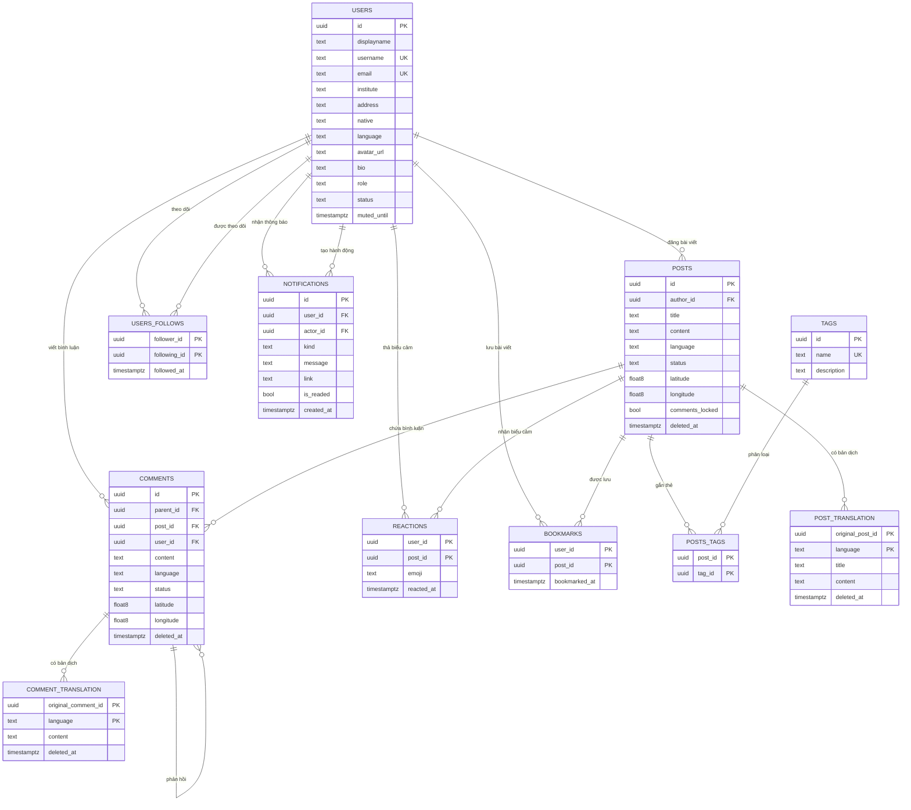

# Mô hình dữ liệu 

Etsubi tổ chức dữ liệu xoay quanh **11 thực thể nghiệp vụ** trên cơ sở dữ liệu PostgreSQL, bao quát toàn bộ hoạt động từ quản lý tài khoản, đăng tải nội dung, tương tác cộng đồng cho tới dịch thuật tự động và gửi thông báo.

## Sơ đồ quan hệ tổng thể

## Phân nhóm thực thể nghiệp vụ

| Nhóm nghiệp vụ | Thực thể | Vai trò và cách thức hoạt động |
| --- | --- | --- |
| **Người dùng và kết nối** | `users`, `users_follows` | Lưu trữ thông tin hồ sơ cá nhân, vai trò phân quyền, trạng thái hoạt động và ngôn ngữ sử dụng. Quan hệ theo dõi cho phép các tài khoản kết nối một chiều với nhau. |
| **Nội dung thảo luận** | `posts`, `comments` | Lưu trữ bài viết và bình luận kèm ngôn ngữ gốc, tọa độ địa lý tùy chọn và trạng thái kiểm duyệt. Bình luận hỗ trợ trả lời lồng nhau nhiều cấp thông qua liên kết tới bình luận cha. |
| **Tương tác và phân loại** | `reactions`, `bookmarks`, `tags`, `posts_tags` | Quản lý danh sách bài viết đã lưu, biểu cảm của người dùng trên từng bài viết và hệ thống thẻ chủ đề phục vụ việc phân loại, tìm kiếm nội dung. |
| **Bản dịch tự động** | `post_translation`, `comment_translation` | Lưu trữ kết quả chuyển ngữ tiêu đề và nội dung của bài viết hoặc bình luận theo từng ngôn ngữ đích để tái sử dụng cho các lần truy cập sau. |
| **Thông báo hệ thống** | `notifications` | Ghi nhận các thông báo gửi tới người dùng khi có nhắc tên, có bài viết mới từ tác giả đang theo dõi hoặc thông báo từ quản trị viên, kèm đường dẫn điều hướng và trạng thái đã đọc. |

## Tập giá trị quy ước

| Thực thể | Thuộc tính | Giá trị quy ước | Ý nghĩa |
| --- | --- | --- | --- |
| `users` | `role` | `user`, `moderator`, `admin` | Cấp bậc phân quyền thao tác trên hệ thống |
| `users` | `status` | `pending`, `active`, `banned` | Trạng thái vòng đời hoạt động của tài khoản |
| `users`, `posts`, `comments` | `language`, `native` | `vi`, `en`, `ja` | Mã ngôn ngữ được hỗ trợ (tiếng Việt, tiếng Anh, tiếng Nhật) |
| `posts`, `comments` | `status` | `published`, `hidden` | Trạng thái hiển thị công khai hoặc bị ẩn do kiểm duyệt |
| `notifications` | `kind` | `mention`, `new_post`, `system` | Phân loại sự kiện phát sinh thông báo |

## Ràng buộc dữ liệu cốt lõi

* **Định danh và thời gian chuẩn hóa**: Mọi thực thể độc lập đều sử dụng mã định danh duy nhất toàn cầu (UUID). Toàn bộ mốc thời gian tạo, cập nhật hoặc hết hạn đều được lưu theo chuẩn giờ quốc tế (UTC).
* **Mỗi tài khoản một tương tác trên mỗi bài viết**: Hai thực thể `reactions` và `bookmarks` sử dụng khóa chính kép `(user_id, post_id)`. Khi người dùng thay đổi biểu cảm, hệ thống cập nhật trực tiếp giá trị `emoji` và thời điểm `reacted_at` trên bản ghi hiện có thay vì tạo thêm bản ghi mới.
* **Ngăn chặn tự tương tác**: Thực thể `users_follows` sử dụng khóa chính kép `(follower_id, following_id)` và chặn trường hợp người dùng tự theo dõi chính mình. Tương tự, hệ thống không phát sinh thông báo tự nhắc tên chính chủ tài khoản.
* **Tọa độ địa lý theo cặp**: Hai thuộc tính `latitude` ($[-90, 90]$) và `longitude` ($[-180, 180]$) trên bài viết và bình luận bắt buộc phải cùng có giá trị hoặc cùng để trống.
* **Cấu trúc thảo luận phân cấp**: Thuộc tính `parent_id` của bình luận tự tham chiếu tới chính thực thể `comments`, cho phép tổ chức các chuỗi phản hồi nhiều cấp trong cùng một bài viết.

## Vòng đời dữ liệu và bộ nhớ đệm

* **Xóa mềm (Soft-delete)**: Các thực thể `posts`, `comments`, `post_translation` và `comment_translation` sử dụng thuộc tính `deleted_at`. Khi nội dung bị xóa, bản ghi được đánh dấu thời điểm xóa để ẩn khỏi giao diện hiển thị thông thường nhưng vẫn được giữ lại phục vụ công tác kiểm duyệt và khôi phục khi cần thiết.
* **Làm mới bản dịch tự động**: Khi tác giả chỉnh sửa tiêu đề hoặc nội dung gốc của bài viết hoặc bình luận, các bản dịch tương ứng trong `post_translation` và `comment_translation` được đánh dấu hết hiệu lực qua `deleted_at` để hệ thống tạo lại bản dịch mới khớp với nội dung cập nhật ở lần truy cập tiếp theo.
* **Xóa vĩnh viễn (Hard-delete)**: Các liên kết tương tác như `reactions`, `bookmarks`, `users_follows` và `posts_tags` được gỡ bỏ trực tiếp khi người dùng hủy thao tác. Khi một tài khoản `users` chủ động xóa tài khoản, toàn bộ dữ liệu liên quan thuộc quyền sở hữu của tài khoản đó cũng được xóa bỏ hoàn toàn khỏi hệ thống.

## Ví dụ luồng dữ liệu: Đăng bài và đọc bản dịch

1. **Khởi tạo bài viết**: Thành viên A đăng một bài viết bằng tiếng Nhật (`posts.language = 'ja'`) và gắn 2 thẻ chủ đề. Hệ thống tạo 1 bản ghi trong `posts` và 2 bản ghi liên kết trong `posts_tags`.
2. **Phát thông báo tới người theo dõi**: Hệ thống truy xuất danh sách những người đang theo dõi A từ `users_follows` và khởi tạo các bản ghi thông báo tương ứng trong `notifications` với trạng thái chưa đọc (`is_readed = false`).
3. **Chuyển ngữ theo ngôn ngữ người đọc**: Thành viên B cài đặt ngôn ngữ giao diện là tiếng Việt (`users.language = 'vi'`) truy cập vào bài viết. Hệ thống kiểm tra bản dịch trong `post_translation` theo cặp khóa `(post_id, 'vi')`; nếu chưa tồn tại sẽ tiến hành dịch nội dung và lưu kết quả vào `post_translation` để tái sử dụng cho các thành viên tiếng Việt khác.
